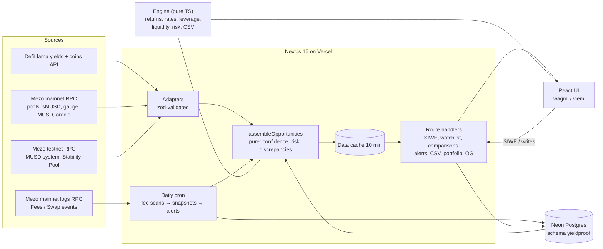

# YieldProof — See Beyond APY

[](https://github.com/happypapa636/YieldProof/actions/workflows/ci.yml)

**Live app: https://yieldproof-mezo.vercel.app**

Transparent net-yield analytics for MUSD and the Mezo ecosystem. YieldProof shows you where the yield comes from, what it costs, what could go wrong, and what you might actually keep.

> Analytics only. Projections are estimates from visible assumptions and backward-looking data — not guarantees, forecasts, or financial advice. YieldProof never custodies funds and deploys no smart contract of its own.

---

## The problem

DeFi dashboards lead with an advertised APY. That number hides gas, borrowing interest, deposit/withdrawal fees, slippage through thin pools, incentive-token price risk, impermanent loss, lock-ups and liquidation risk. On Mezo today the highest headline (veMEZO, ~36% APY) is paid in rebases of a volatile token behind a lock of up to four years, while a 10,000 MUSD BTC/MUSD LP position *loses* money after on-chain slippage through a ~$120k pool.

## The solution

YieldProof prices every Mezo yield source with **one documented cost model**, reproduces API numbers from **chain state** where it can, labels every metric with its **source and timestamp**, and shows a waterfall from *advertised* to *estimated net* for whatever capital, horizon and assumptions you choose.

## What works (all live)

| Area | What you get |
|---|---|
| **Live opportunities** | 10 Mezo strategies: MUSD Savings Vault (sMUSD), sMUSD gauge (MEZO emissions), veBTC, veMEZO, Boar Finance BTC relay, 3 official MUSD pools (BTC/MUSD, mUSDC/MUSD, MUSD/mUSDT), a modeled *borrow MUSD against BTC → sMUSD* loop, and the testnet MUSD Stability Pool. New DefiLlama Mezo pools are auto-discovered and shown as unreviewed. |
| **Net-return engine** | Gross base + realised incentives − (tx, deposit/withdrawal/performance fees, entry/exit slippage, borrow interest + fee, reinvestment fees, modeled IL). APR↔APY with explicit basis, none/daily/weekly/monthly compounding only where realistic, incentive-price sensitivity (100/75/50/0%), rate-change scenarios, honest negative returns. 40-digit decimal maths, bigint token units. |
| **On-chain cross-checks** | sMUSD yield recomputed from the `MUSDSavingsRate.yieldIndex` at archived blocks; gauge APR from `VaultGauge.rewardRate`; pool fee APR from 7 days of `Fees` events; exit slippage from a **wei-exact port of `Pool.getAmountOut`** (stable `x³y+xy³` and volatile `x·y=k`), verified in tests against live mainnet quotes. |
| **Leverage analyzer** | MUSD trove maths from live contract parameters (MCR 110%, CCR 150%, 0.1% issuance fee, 200 MUSD gas deposit, 1% rate): ICR, health factor, liquidation price, leverage ratio, break-even yield, 14-row stress grid (price, yield, borrow rate, liquidity). |
| **Liquidity & exit** | Hypothetical exit size → slippage, exit value, pool depth and reserve imbalance; slippage curve 1k–100k MUSD; lock-up handling. |
| **Risk model** | 11 component indicators with documented thresholds, evidence links (Mezo audits page, docs), "Insufficient data" when evidence is missing, never "safe"; unaudited/unknown-audit protocols never rated below Elevated. |
| **Confidence & freshness** | Verified / Partial / Demo with reasons; fresh/aging/stale per source timestamp; unavailable ≠ 0 everywhere. |
| **Sources & discrepancies** | BTC price (Mezo oracle vs testnet oracle vs DefiLlama vs pool spot), MUSD price (peg vs DefiLlama vs both stable pools), sMUSD APY and gauge APR (DefiLlama vs chain), audit coverage (DefiLlama vs Mezo docs). |
| **Comparison** | 2–4 strategies, shared assumptions, ending-value and net charts, side-by-side table with key risks and liquidity limits, CSV export, shareable link (ids + assumptions only), printable report, OG share card. |
| **History** | DefiLlama archived daily series + YieldProof's own daily snapshots (incl. its estimated net), 7D/30D/90D/1Y only when real data reaches back, sample counts, coverage and longest gap. Never interpolated. |
| **MUSD explorer** | Opportunities grouped by use case (lending/savings, liquidity, stablecoin, borrowing, other) with plain-language explainers and honest empty states; live MUSD vitals. |
| **Wallet & portfolio** | EIP-6963 injected wallets, add/switch Mezo Testnet, add MUSD to wallet. Read-only positions: MUSD/BTC balances (testnet + mainnet), testnet Stability Pool deposit + BTC gain, trove status/ratio, sMUSD balance/claimable yield/gauge stake. Supported protocols listed explicitly. |
| **Testnet practice (on-chain)** | Deposit to / withdraw from the real MUSD Stability Pool on Mezo **testnet** from Portfolio or the Stability Pool page: every action is simulated first, summarised in a confirmation dialog, then signed in your wallet; explorer links for every tx; the panel warns up front when the protocol blocks withdrawals (any trove below 110%). Mainnet is never written to. |
| **Watchlist, comparisons, alerts** | Sign-In with Ethereum → watchlist, saved comparisons, settings, and 7 alert types (yield/incentive/liquidity thresholds, borrow cost, stale data, parameter change, net turning negative). Checked by the daily cron **and** on every visit, with honest "last checked" times; in-app notifications. |
| **Demo** | Four clearly FICTIONAL strategies (lending, incentive farm, LP with IL, 3× loop), every knob live, showing that the highest advertised APY is not the highest net. |
| **Plain-language verdict** | Every projection opens with one sentence: what you might keep (or lose) on your capital and horizon, what the headline implied, and the single biggest reason they differ. |
| **Extras** | ⌘K / Ctrl-K search over pages and strategies, notification bell with unread count, searchable table with click-to-sort columns, methodology page with every formula, assumption ledger on every projection, OG cards, sitemap/robots, legal page, live network status, printable reports, Vercel Analytics. |
| **Design** | Neutral charcoal plus two signal colours: green for what you keep (gains, verified data, primary actions) and red for what you lose (costs, losses, high risk). No gradients, glass or decorative 3D; risk is a 4-step intensity meter rather than a rainbow. The landing hero is the live advertised-vs-net chart itself. Tokens live in `src/app/globals.css` and `src/lib/palette.ts`. |

## Architecture



## How it works

1. **Read**: every 10 minutes (on demand, cached) YieldProof pulls DefiLlama's Mezo pools and prices (known pools individually; discovery of new pools from the 10 MB full list waits at most 6 s on a page request and always completes in the daily cron), and reads Mezo mainnet (pool reserves & fees, sMUSD index now / 7d / 30d ago via archive reads, gauge reward rate, MUSD parameters, BTC oracle) and Mezo testnet (MUSD system, Stability Pool) through multicall.
2. **Verify**: API rates are recomputed from chain state; agreement within tolerance earns *Verified*. Disagreements are surfaced, never averaged.
3. **Price costs**: gas at the live Mezo gas price × oracle BTC price; slippage from exact pool maths at *your* position size; MUSD borrow costs from the contracts.
4. **Project**: the engine converts every quote to a simple APR with an explicit compounding basis, then applies your horizon, compounding, incentive-price and rate scenarios. Every input is listed in the assumption ledger.
5. **Assess risk**: evidence → component levels → overall category, or "Insufficient data".
6. **Remember**: a daily Vercel Cron scans 7 days of pool `Fees` events, snapshots every metric into Postgres (YieldProof's own history) and evaluates alerts.

## Methodology (summary)

```
Net Profit = Gross Base Yield + Realised Incentive Value − Estimated Costs
APY = (1 + APR/n)^n − 1        APR = n·((1+APY)^(1/n) − 1)      (quotes converted with n = 365)
Volatile pool:  out = a'·R_out/(R_in + a'),  a' = a − a·fee/10000
Stable pool:    x³y + xy³ = k, solved by Newton's method on 1e18-normalised reserves
IL (50/50):     2√r/(1+r) − 1
MUSD:           ICR = coll·P / (borrow·(1+fee) + 200);  HF = ICR / 1.10;  P_liq = debt·1.10 / coll
sMUSD realised: ΔyieldIndex / 1e18 × 31,536,000 / seconds
```

The full derivations, thresholds and rules are on [/methodology](https://yieldproof-mezo.vercel.app/methodology).

## Data sources

| Source | Type | Used for |
|---|---|---|
| [DefiLlama yields](https://yields.llama.fi/pools) (`chain === "Mezo"`, `poolsEnriched`, `/chart/<id>`) | API | Advertised / base / reward APY, TVL, daily history |
| [DefiLlama coins](https://coins.llama.fi) | API | MEZO, MUSD, BTC prices (gauge cross-check, discrepancy view) |
| Mezo mainnet RPC (`mezo.drpc.org`, fallback validationcloud) | On-chain | Reserves, fees, sMUSD index, gauge, MUSD params, oracle |
| Mezo mainnet logs (`mainnet.mezo.public.validationcloud.io`) | On-chain | 7-day `Fees`/`Swap` scans (daily cron) |
| Mezo testnet RPC (`rpc.test.mezo.org`) | On-chain | MUSD system, Stability Pool, portfolio |
| [Mezo docs](https://mezo.org/docs/users/resources/audits/) | Documentation | Audits, fees, lock rules, vault terms |

## Mezo / MUSD integration — every contract read

YieldProof **does not deploy a contract** (the spec says not to create one merely to look integrated). All reads below; the only writes are the user's own optional testnet actions.

**Mezo mainnet (31612) — read-only analytics**

| Contract | Address |
|---|---|
| MUSD | [0xdD468A1DDc392dcdbEf6db6e34E89AA338F9F186](https://explorer.mezo.org/address/0xdD468A1DDc392dcdbEf6db6e34E89AA338F9F186) |
| BorrowerOperations (MUSD minter) | [0x44b1bac67dDA612a41a58AAf779143B181dEe031](https://explorer.mezo.org/address/0x44b1bac67dDA612a41a58AAf779143B181dEe031) |
| InterestRateManager | [0x4a453700d157717Fe02fB62E7700ED7845048285](https://explorer.mezo.org/address/0x4a453700d157717Fe02fB62E7700ED7845048285) |
| PriceFeed | [0xc5aC5A8892230E0A3e1c473881A2de7353fFcA88](https://explorer.mezo.org/address/0xc5aC5A8892230E0A3e1c473881A2de7353fFcA88) |
| TroveManager | [0x94AfB503dBca74aC3E4929BACEeDfCe19B93c193](https://explorer.mezo.org/address/0x94AfB503dBca74aC3E4929BACEeDfCe19B93c193) |
| StabilityPool | [0x73245Eff485aB3AAc1158B3c4d8f4b23797B0e32](https://explorer.mezo.org/address/0x73245Eff485aB3AAc1158B3c4d8f4b23797B0e32) |
| sMUSD / MUSDSavingsRate | [0xb4D498029af77680cD1eF828b967f010d06C51CC](https://explorer.mezo.org/address/0xb4D498029af77680cD1eF828b967f010d06C51CC) |
| sMUSD VaultGauge | [0x677817bF3e44b90E8F95222F75e2950b7904a401](https://explorer.mezo.org/address/0x677817bF3e44b90E8F95222F75e2950b7904a401) |
| veBTC / veMEZO | [0x3D4b…f279](https://explorer.mezo.org/address/0x3D4b1b884A7a1E59fE8589a3296EC8f8cBB6f279) / [0xb90f…0122](https://explorer.mezo.org/address/0xb90fdAd3DFD180458D62Cc6acedc983D78E20122) |
| PoolFactory | [0x83FE469C636C4081b87bA5b3Ae9991c6Ed104248](https://explorer.mezo.org/address/0x83FE469C636C4081b87bA5b3Ae9991c6Ed104248) |
| BTC/MUSD pool (volatile, 0.30%) | [0x52e604c44417233b6CcEDDDc0d640A405Caacefb](https://explorer.mezo.org/address/0x52e604c44417233b6CcEDDDc0d640A405Caacefb) |
| mUSDC/MUSD pool (stable, 0.02%) | [0xEd812AEc0Fecc8fD882Ac3eccC43f3aA80A6c356](https://explorer.mezo.org/address/0xEd812AEc0Fecc8fD882Ac3eccC43f3aA80A6c356) |
| MUSD/mUSDT pool (stable, 0.02%) | [0x10906a9E9215939561597b4C8e4b98F93c02031A](https://explorer.mezo.org/address/0x10906a9E9215939561597b4C8e4b98F93c02031A) |

**Mezo testnet (31611)**

| Contract | Address |
|---|---|
| MUSD | [0x118917a40FAF1CD7a13dB0Ef56C86De7973Ac503](https://explorer.test.mezo.org/address/0x118917a40FAF1CD7a13dB0Ef56C86De7973Ac503) |
| BorrowerOperations | [0xCdF7028ceAB81fA0C6971208e83fa7872994beE5](https://explorer.test.mezo.org/address/0xCdF7028ceAB81fA0C6971208e83fa7872994beE5) |
| TroveManager | [0xE47c80e8c23f6B4A1aE41c34837a0599D5D16bb0](https://explorer.test.mezo.org/address/0xE47c80e8c23f6B4A1aE41c34837a0599D5D16bb0) |
| PriceFeed | [0x86bCF0841622a5dAC14A313a15f96A95421b9366](https://explorer.test.mezo.org/address/0x86bCF0841622a5dAC14A313a15f96A95421b9366) |
| StabilityPool | [0x1CCA7E410eE41739792eA0A24e00349Dd247680e](https://explorer.test.mezo.org/address/0x1CCA7E410eE41739792eA0A24e00349Dd247680e) |
| InterestRateManager | [0xD4D6c36A592A2c5e86035A6bca1d57747a567f37](https://explorer.test.mezo.org/address/0xD4D6c36A592A2c5e86035A6bca1d57747a567f37) |

## Project layout

```
src/app/(app)/      pages: dashboard, opportunities, compare, risk, history, musd, sources, portfolio, ...
src/app/api/        route handlers: SIWE auth, watchlist, comparisons, alerts, CSV, portfolio, OG, cron
src/components/     UI: charts, tables, projection + waterfall, testnet Stability Pool actions
src/config/         chains, contract addresses, wagmi
src/lib/engine/     pure maths: returns, rates, leverage, liquidity, risk, confidence, CSV
src/lib/data/       DefiLlama + on-chain adapters, registry, dataset assembly
src/lib/model/      projections, comparisons, alerts, plain-language explanations
src/lib/db/         Neon client, queries, schema.sql
src/lib/jobs/       the daily snapshot job
scripts/            migrate, snapshot, e2e
tests/              Vitest unit tests
```

## Tech stack

Next.js 16 (App Router, Turbopack) · React 19 · TypeScript strict · Tailwind CSS v4 · Radix primitives · wagmi 2 + viem 2 + TanStack Query · Recharts · decimal.js · zod · jose · Neon Postgres (`@neondatabase/serverless`) · Vitest · Vercel (Cron, Analytics).

## Local setup

Requires Node 22.12+ or 24 (see `.nvmrc`).

```bash
npm install
vercel link --yes --project yieldproof-mezo     # or create .env.local from .env.example
vercel env pull .env.local --yes
npm run db:migrate                              # idempotent; creates schema "yieldproof"
npm run snapshot                                # optional: first fee scan + snapshot
npm run build && npm start                      # or: npm run dev
```

### npm scripts

| Script | What it does |
|---|---|
| `dev` / `build` / `start` | Next.js dev server, production build, production server |
| `lint` / `typecheck` / `test` | ESLint, `tsc --noEmit`, Vitest unit tests |
| `check` | All three above, as CI runs them |
| `db:migrate` | Create or update the `yieldproof` Postgres schema (idempotent) |
| `snapshot` | Run the daily cron job locally: fee scans, snapshots, alerts |
| `e2e` | End-to-end suite against `BASE_URL` (see Testing) |

### Environment variables (`.env.example`)

| Variable | Purpose |
|---|---|
| `DATABASE_URL` | Neon Postgres (provided by the Vercel integration) |
| `SESSION_SECRET` | HS256 key for SIWE session JWTs (≥ 32 random bytes) |
| `CRON_SECRET` | Bearer secret Vercel Cron sends to `/api/cron/snapshot` |
| `MEZO_TESTNET_RPC_URL`, `MEZO_MAINNET_RPC_URL`, `MEZO_MAINNET_LOGS_RPC_URL` | Optional RPC overrides |
| `NEXT_PUBLIC_SITE_URL` | Canonical URL for OG/sitemap (defaults to the production URL) |

## Database (schema `yieldproof`)

| Table | Purpose |
|---|---|
| `siwe_nonces` | Server-issued single-use nonces with 10-minute expiry |
| `users` | Wallet addresses that signed in |
| `watchlist` | `(address, opportunity_id)` unique |
| `saved_comparisons` | Strategy ids + assumptions (jsonb) |
| `user_settings` | Default assumptions |
| `alerts` / `notifications` | Alert rules, state, last checked/triggered; in-app notifications |
| `metric_snapshots` | Daily per-metric observations `(opportunity_id, metric, day)` unique — YieldProof's own history |
| `fee_windows` | Cached 7-day on-chain fee scans per pool |
| `cron_runs` | Job runs with status and report |

## Testing

```bash
npm test                                   # Vitest: 102 tests
npm run check                              # lint + typecheck + tests (what CI runs)
BASE_URL=http://localhost:3000 npm run e2e # end-to-end against a running app
```

The e2e suite runs on any machine: without a funded key it generates an ephemeral wallet and skips the on-chain section. To include real testnet transactions, point `TEST_WALLETS_FILE` at a JSON file outside the repo shaped like `{"yieldproof":[{"role":"user","address":"0x…","privateKey":"0x…"}]}` holding a testnet-only key with test MUSD. `E2E_OUT=path.json` saves the report.

**Latest results (2026-11-14)**

- Unit tests: **102 / 102 passing** (9 files): net return, APR/APY, compounding, variable rates, incentive sensitivity, negative returns, entry/exit costs, borrowing, MUSD leverage & health factor, stress tests, token decimals, missing/stale data, inconsistent sources, liquidity & slippage (**wei-exact vs live `Pool.getAmountOut`**), IL, risk model, CSV escaping & formula injection, demo vs live separation, alerts, the advertised → net **waterfall** (every bar keeps its own label; floating bars land exactly on the net), the plain-language verdict, summary statistics and display formatting ("Unavailable" never shown as 0). GitHub Actions runs lint, typecheck and these tests on every push and pull request.
- E2E (`scripts/e2e-testnet.ts`): **52 / 52 passing** against the production build: all 18 page routes render with live data, unknown-strategy view, SIWE login + replay/wrong-domain/forged-signature negatives, watchlist, saved comparison, alerts + in-app notification, cross-wallet authorization negatives, CSV content, portfolio = on-chain balance, cleanup, and **real Mezo testnet transactions** verified through the app's portfolio API: approve [0xba4488c6…](https://explorer.test.mezo.org/tx/0xba4488c6d34390e7353e0e193a0edd2d6cb0c7052ccb64c0ceda604d6b61319b), `provideToSP(1 MUSD)` [0x137dfdf4…](https://explorer.test.mezo.org/tx/0x137dfdf402686ca664740fab4b17e244dfb5ef829acd7c246fcb6c8cf1a43e9b), `withdrawFromSP(1 MUSD)` [0x98fc081e…](https://explorer.test.mezo.org/tx/0x98fc081e3fcd56a912c3da709d4b6970421740ab4ab05a9c7b117d7f442a32e1).
- Browser walkthrough of the new UI with a test wallet (Playwright + an EIP-6963 test provider): connect, Sign-In with Ethereum, Stability Pool deposit of 25 test MUSD (approve [0x9417904f…](https://explorer.test.mezo.org/tx/0x9417904f466227e3f1f22330b0a09ca6697701a6d2a1639d0eacaabc0995a602) + deposit [0xac1fbd8b…](https://explorer.test.mezo.org/tx/0xac1fbd8b57718682fa233010eb5c4201ffbb43515022a68614a73180f3d59739)), withdrawal of 10 ([0x415bab75…](https://explorer.test.mezo.org/tx/0x415bab75eeb15c626e01e77142b228c16be5c5c4ebd419b417057c6efa8fbc5b)), watchlist add, alert, notification bell.
- Production (https://yieldproof-mezo.vercel.app, deployed 2026-11-14): **52 / 52 passing**, including approve [0xdbf5344a…](https://explorer.test.mezo.org/tx/0xdbf5344a5cf687ae5db4bc6e8df109d7a37f8b54ec6b523cc362113c2e2b332a), `provideToSP` [0x16ebb836…](https://explorer.test.mezo.org/tx/0x16ebb83647ab5578c86e8e0ef9672db6cb40092bce90d2bb92969123150d4b76) and `withdrawFromSP` [0x8d0caf7e…](https://explorer.test.mezo.org/tx/0x8d0caf7e04e4e910000d495444a44aad757ac5b978ca0515515ef36ef992deed); no runtime errors in the logs after deploy.
- `npm run build` (0 type errors), `npm run lint` clean.

## Security model

- Non-custodial and read-only by default; never requests keys or seed phrases. The only writes are user-confirmed **testnet** Stability Pool deposits/withdrawals (simulated first, shown in a confirmation dialog, signed in the user's own wallet). Nothing is ever sent on mainnet.
- Writes require **Sign-In with Ethereum** (EIP-4361): server-issued single-use nonce (consumed atomically after signature check), domain + URI origin + chain id + issued-at/expiry validated, EOA and ERC-1271/6492 signatures via viem; session = HttpOnly, SameSite=Lax (Secure on HTTPS) HS256 JWT.
- Every query is parameterised and scoped to the signed-in address; zod validation on every input; payload size caps; per-user limits.
- Cron protected by `CRON_SECRET`; secrets only in Vercel env; security headers (nosniff, frame deny, referrer policy).
- CSV exports neutralise spreadsheet formulas and never include wallet data; share links carry ids and assumptions only.
- Demo data is namespaced (`demo-*`), labelled FICTIONAL, rejected by live endpoints and guarded by `assertLiveOnly` / `assertDemoOnly`.

## Known limitations

- **Gauge emissions for Mezo Pools are not verified** (the factory's `voter()` is a multisig, so no gauge registry is readable); pool incentives show "Not verified" and pool estimates are Partial.
- veBTC, veMEZO and Boar Finance rates are **API-only** (Partial). Boar's audit status and contracts are not published in Mezo docs.
- Projections hold the deposit asset's price constant (BTC/MEZO price moves are covered only via IL and leverage stress tests). MUSD is valued at $1 by assumption; the live market price is shown in Sources.
- Gas units per action are documented estimates priced at the live gas price (costs are fractions of a cent on Mezo).
- History before YieldProof's first snapshot (2026-10-26) comes only from DefiLlama; strategies DefiLlama does not track have short histories.
- Monitoring is **daily** (Vercel Hobby cron) plus on-visit checks — not continuous. Notifications are in-app only (no email).
- Portfolio covers MUSD/BTC balances, testnet Stability Pool, troves and sMUSD — not veBTC/veMEZO locks, LP positions or other protocols.
- Stability Pool withdrawals revert while any testnet trove is below 110% (a protocol rule). The practice panel reads the lowest trove's ratio and says so before you try.
- The demo test wallet (`0x72A5…7391`) has an open testnet trove (0.048 BTC against 2,001.8 MUSD debt, about 160%), 15 test MUSD in the Stability Pool, one watchlist entry and one alert, so Portfolio and Watchlist have something to show.
- An unknown `/opportunities/<id>` renders the not-found page with HTTP 200 (streaming starts before the lookup); it is marked `noindex`.

## Two-minute demo script

1. Open the [landing page](https://yieldproof-mezo.vercel.app): the hero chart is live, each Mezo strategy's advertised rate (dashed) against what YieldProof estimates you keep (solid).
2. **Dashboard** → note sources responding, the discrepancy banner, and the BTC/MUSD LP row: positive fee yield but a negative estimated net at 10,000 MUSD.
3. Click **BTC/MUSD liquidity** → assumption ledger shows ~4% entry and exit slippage computed from live reserves; drag *Horizon* and *LP price move*; open the exit-slippage curve.
4. **Borrow MUSD against BTC → sMUSD** → leverage analyzer: move the BTC price shock until the trove becomes liquidatable; read the stress grid.
5. **Compare** → sMUSD vs gauge vs LP; *Export CSV*, *Copy share link*.
6. **Sources** → the BTC price from four places and the sMUSD APY recomputed on-chain.
7. **Demo** → drag *Incentive token price* to 0 and *Borrowing cost* up: the highest headline (Lever Loop, 31.5%) is not the best net.
8. Optional wallet: get testnet BTC from the [Mezo faucet](https://faucet.test.mezo.org/), connect, *Sign in with Ethereum*, add a strategy to the watchlist, set an alert (the bell lights up), open **Portfolio** and deposit test MUSD into the Stability Pool; follow the explorer link.

## Pitch & roadmap

**Pitch:** most yield tools tell you what a protocol advertises. YieldProof tells you what you'd keep — and proves each number with a source, a timestamp and an on-chain cross-check, starting with MUSD on Mezo.

**Roadmap:** verify Mezo gauge emissions once a voter registry is published · veBTC/veMEZO and LP position discovery · email/Telegram alerts · hourly monitoring on a paid plan · per-epoch veBTC reward decomposition · MEZO/MUSD price exposure scenarios · more chains where MUSD is bridged (Ethereum, Base).
